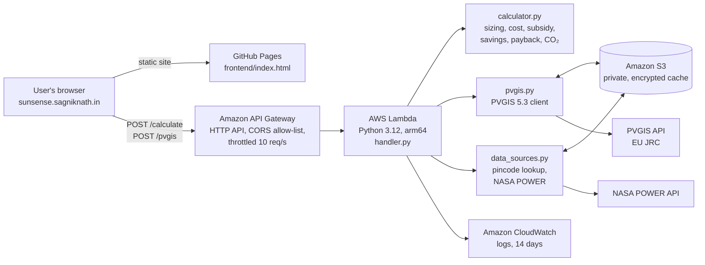
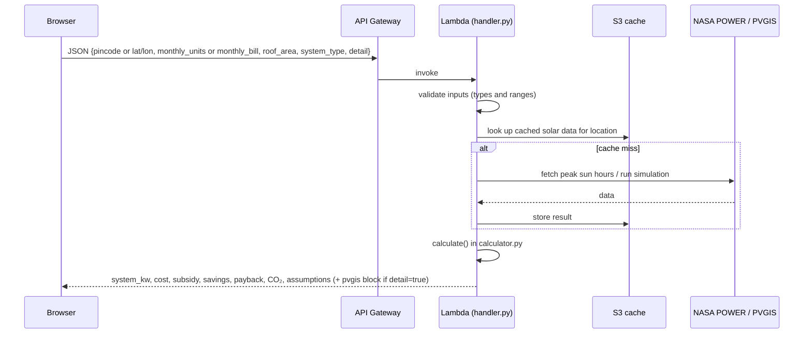

# SunSense: Technical Design Document

## 1. Purpose

SunSense helps an Indian household answer three questions before going solar: how big a rooftop system it needs, what it will cost after the PM Surya Ghar subsidy, and how long it takes to pay back. It also reports yearly generation, bill savings and CO₂ avoided.

## 2. System overview



Infrastructure is defined as code in `template.yaml` (AWS SAM / CloudFormation) and deployed with `deploy.sh`. Region: `ap-south-1` (Mumbai).

## 3. Components

| Component | File | Responsibility |
|---|---|---|
| Frontend source | `src/app.html` | 3D globe (CesiumJS), location search, calculator form, results, Solar lab |
| Build tool | `tools/build_index.py` | Builds `frontend/index.html` from `src/app.html`, adds CSP hashes and SRI |
| Lambda entry point | `backend/handler.py` | Routes `/calculate` and `/pvgis`, validates and bounds every input, builds CORS headers |
| Calculator | `backend/calculator.py` | Pure maths, no AWS calls: sizing, generation, cost, subsidy, tariff slabs, payback, CO₂ |
| PVGIS client | `backend/pvgis.py` | Detailed roof simulation and the seven Solar lab tools |
| Data sources | `backend/data_sources.py` | Pincode → coordinates, NASA POWER peak sun hours, S3 or local cache |
| Dev server | `backend/dev_server.py` | Serves the site and API locally on port 8000 |
| Tests | `backend/tests/` | Calculator, handler, PVGIS, Solar lab and security fuzz tests |

## 4. Request flow (`POST /calculate`)



If PVGIS cannot be reached, the API returns the quick estimate instead of failing, and the page explains why. The browser also shows an instant estimate from a bundled India yield grid while the full simulation loads.

## 5. Calculation model

| Step | Formula |
|---|---|
| Size | `kWp = monthly_units ÷ (30 × peak_sun_hours × 0.8)`, capped at `roof_area ÷ 10`, rounded to 0.05 kW |
| Generation | `kWp × peak_sun_hours × 365 × 0.8` (replaced by the PVGIS result when available) |
| Gross cost | `kWp × ₹55,000` |
| Subsidy (on-grid) | ₹30,000/kW for the first 2 kW + ₹18,000 for the 3rd kW, capped at ₹78,000 |
| Savings | Bill before − bill after on the state tariff (net metering) |
| Payback | `net cost ÷ yearly savings` |
| CO₂ avoided | `yearly kWh × 0.82 kg` (CEA grid emission factor) |

State tariffs for 33 states/UTs are stored in `frontend/assets/tariffs.json`. A raw `monthly_bill` sent directly to the API is converted with WBSEDCL (West Bengal) domestic slabs.

## 6. Security

- Content Security Policy with script hashes and Subresource Integrity on CDN scripts
- Strict input validation and numeric bounds in `handler.py`; NaN/Infinity rejected
- CORS allow-list limited to the site's own origins
- API Gateway throttling
- S3 bucket private, encrypted, HTTPS-only, least-privilege IAM policy for the Lambda
- Fuzz tests in `backend/tests/test_security.py`

## 7. Testing

```bash
cd backend && python -m pytest -q
```

Example inputs and real outputs are in [`../sample_data/`](../sample_data/).

## 8. Scalability and next steps

- Serverless design scales with demand and has no idle cost.
- Location-based tariff selection already covers 33 states/UTs, so the tool works beyond West Bengal.
